<h1 align="center">Hi, I'm Harry 👋</h1>

  

  
  

---

### 🍄 About me

- 🔭 I'm currently working on **…**
- 🌱 I'm currently learning **…**
- ⚡ Fun fact: **…**

### 🧱 Tech I build with

  

### 🎮 Contribution World

  <picture>
    <source media="(prefers-color-scheme: dark)" srcset="dist/mario-contributions-night.svg" />
    <source media="(prefers-color-scheme: light)" srcset="dist/mario-contributions-day.svg" />
    
  </picture>

Every block is a day of contributions — refreshed daily by GitHub Actions.

### 📊 Stats

  
  

